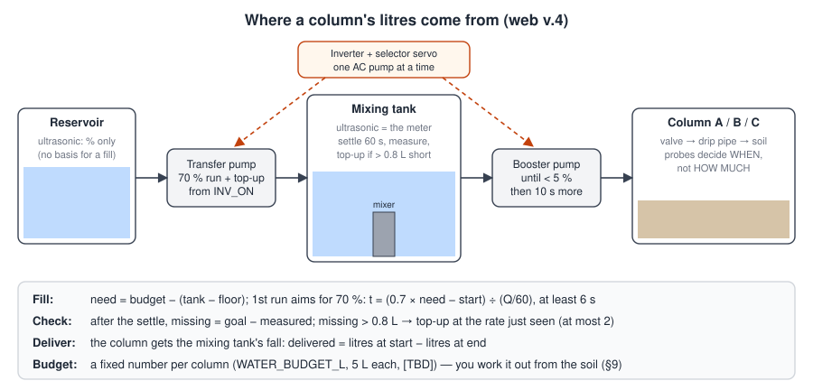
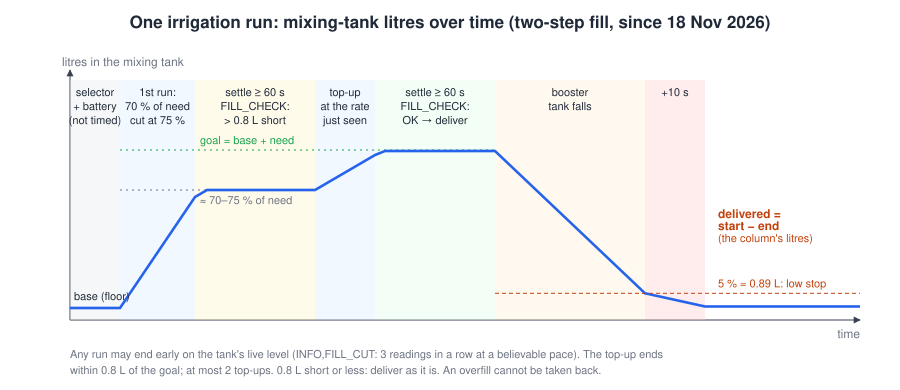
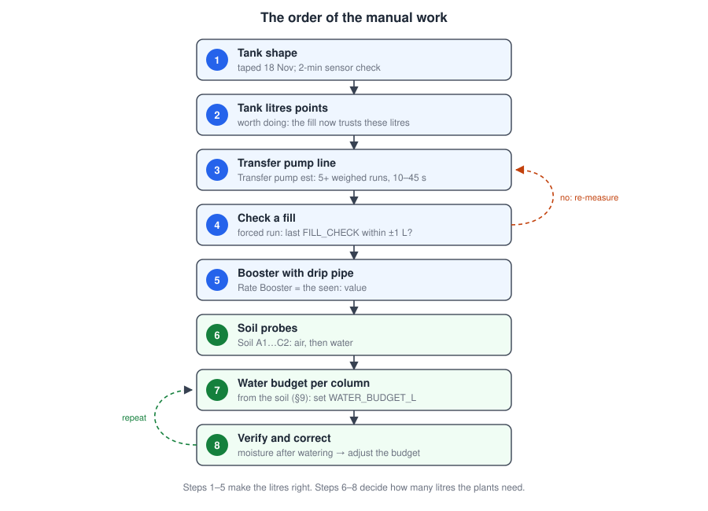
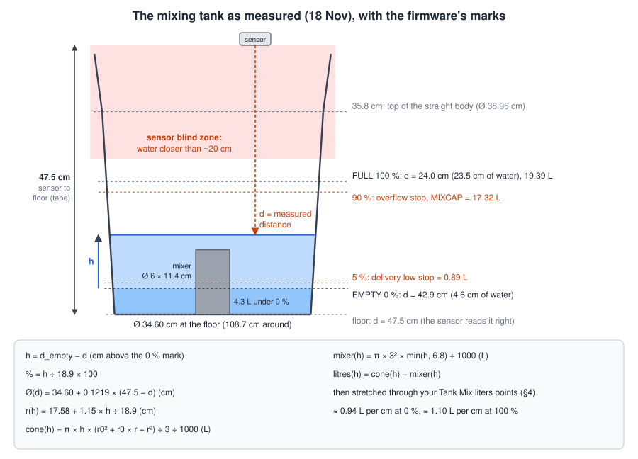
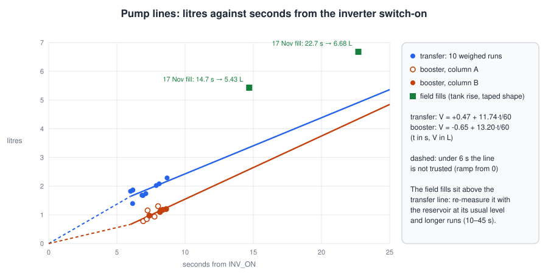
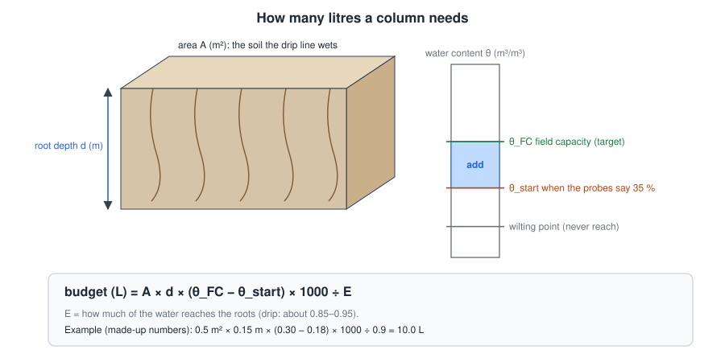

# Accurate litres: the manual work and the formulas (web v.4)

*18 Nov 2026, updated 19 Nov for the two-step fill. Matches the web v.4 "pure ultrasonic" firmware. Every formula
here is the one the firmware uses; the file and function are named so it can be checked. Diagrams:
`docs/water_delivery/`.*

This guide covers two separate questions:

1. **Are the litres right?** When the system says it gave a column 5 L, did 5 L reach the column? Two things you
   measure decide it:
   - **The tank calibration** decides how much the system *thinks* is in the tank, and since the two-step fill (18 Nov)
     also how much goes in: the fill measures the tank and tops up what is missing (§3–4).
   - **The transfer pump line** decides how close the first run lands, and so how much work the top-up has left (§5).

   The booster's rate only sets time limits (§7). Sections 3–7.
2. **Is 5 L the right amount?** The firmware does not work out how much water the soil needs. Each column gets a
   fixed amount, `WATER_BUDGET_L`, set in the code (5 L, a placeholder). Section 9 shows how to work out the real
   figure, and section 8 makes sure the probes water at the right time.

**Short of time?** Section 2 says which steps are worth it.

---

## 1. Where a column's litres come from

**One scheduled run, step by step:**

1. **Whether:** inside the column's time window, the run starts if its soil reading is under the start level
   (`soilStartPct`, 35 %). The soil reading never changes *how much* water is given.
2. **How much:** the column's budget, `WATER_BUDGET_L` (`shared/rig_constants.h`). It is a fixed number per column,
   the same every day.
3. **Fill, first run:** the transfer pump runs for a time worked out from about **70 %** of the litres needed,
   counted from the inverter switch-on. It stops early if the tank's live level has already risen 75 % of the need
   (a fast pump). The reservoir is not used as a measure.
4. **Check and top-up:** the mixing tank settles for at least 60 s and its ultrasonic measures it. If it is more
   than **0.8 L** short, a top-up runs, timed with the rate the first run really gave (at most 2 top-ups). The
   top-up stops early once the live level is within 0.8 L of the goal.
5. **Deliver:** the booster empties the mixing tank into the column until the tank is under 5 % for 10 s. **What the
   column receives is the mixing tank's fall**, measured by its ultrasonic.

**What really sets the litres.**
- **The column gets whatever the fill put in the tank.**
- **Since 18 Nov the fill measures and corrects itself.** Before, a top-up ran only when more than 3 L was missing,
  so the pump line set the litres, and the pump's rate changes from run to run (18 Nov: about 11 L/min at 15:33,
  about 19 L/min at 17:34). Fills came in 27 % short to 53 % over. Now a shortfall over 0.8 L is made up, and the
  first run aims low so a fast pump cannot overfill much.
- **So the tank calibration now sets the litres** (within about 1 L), and the receipts report them in the same
  units. A badly calibrated tank therefore delivers wrong *and* reports it as right: the receipt cannot show the
  error. That is why the 2-minute sensor check (§3) and 1–2 litres points (§4) matter more now.
- **An overfill still cannot be taken back.** The shortest top-up (6 s) moves 1.6–2.3 L, so a shortfall just over
  0.8 L can end about 1 L over (18 Nov 21:32: 5.92 L for 5.0 L asked).
- **A run on several columns is one batch.** Both valves open together and the litres asked are the total, so 10 L
  on A+B is about 5 L each. How it splits depends on each line's flow and is not measured.

The first run on the rig with the two-step fill (18 Nov 21:32, A+B, 5.0 L): first run 3.50 L planned, measured 4.12
L (the pump gave 13.49 L/min), top-up for 1.05 L cut at 5.5 s, final 6.19 L against a goal of 5.17 L, 5.92 L
delivered. The same day's single-run fills gave 3.10, 14.90 and 15.32 L for 5, 10 and 10 L.

---

## 2. Is it worth it? The order of the manual work

| # | Task | Section | Your time | What it buys | Worth it? |
| --- | --- | --- | --- | --- | --- |
| 6 | **Soil probes** (calibrate, check they respond) | §8 | 15 min per column | decides *when* to water. A dead probe waters wet soil every day (Column B, 17 Nov) | **Yes, first.** Nothing else matters if the timing is wrong (Column B needs probe B1 repaired before this helps it) |
| 3 | **Transfer pump line** | §5 | 45 min | decides how close the first run lands. Since the two-step fill (18 Nov) the top-up corrects the rest, so an error now costs time and an extra top-up, not litres | **Useful, no longer urgent.** It was the biggest error before 18 Nov (fills 27 % short to 53 % over) |
| 4 | **Check a fill** | §6 | 2 min per run (read the log) | proves 3 worked | **Yes.** Free with every run |
| 7 | **Water budget, quick method** | §9 | 1 h | replaces the 5 L placeholder with a real figure (±20–30 %) | **Yes.** A right amount ±1 L beats an exact wrong amount |
| 2 | **Tank litres points** | §4 | 20 min for 2 points | checks the taped shape and catches what a tape cannot (a dent, the reservoir filter). The fill now decides its top-up from these litres | **Yes, 1–2 points.** The shape was taped on 18 Nov; 1–2 points confirm it, for the plants and for the thesis |
| 5 | **Booster rate through the drip pipe** | §7 | 5 min after a run | right time limits for a delivery; no false stalls | **Yes.** Almost free. The drip catch test (E) is optional: assume 0.9 |
| 1 | **Tank shape and EMPTY distance** | §3 | 10 min | every % and litre | **Only if a sensor or tank was moved or re-aimed.** Marks set 15 Nov, shape taped 18 Nov. Do the 2-minute sensor check in §3 once |
| 7 | **Water budget, soil test** | §9 | about 3 h of work over 3 days | a budget you can defend in the thesis (±10 %) | **For the thesis, yes.** For the plants, the quick method is enough |
| 8 | **Verify and correct** | §9 | 30 min per check | keeps the budget right through the season | **Every few weeks**, or when the crop grows |

**Do these first, about 2 hours in all:** the soil probes, the 2-minute sensor check and 1–2 tank litres points,
then the quick water budget. The two-step fill (18 Nov) already fixed the fills that came in far over or under; the
tank's litres now decide each fill, so they are worth confirming. Re-measure the transfer pump line when there is
time. The soil test then refines the budget.

The rows keep the step numbers of the diagram. Steps 1–5 make the litres right; steps 6–8 decide how many litres the
plants need, and when.

---

## 3. Step 1 — Tank geometry

**Measured by tape on 18 Nov** (inside, wall already deducted; heights above the inside floor):

| Height | Circumference | Diameter |
| --- | --- | --- |
| 0 cm (floor) | 108.7 cm | 34.60 cm |
| 22.6 cm | 117.4 cm | 37.37 cm |
| 35.8 cm (top of the straight body) | 122.4 cm | 38.96 cm |
| 46.0 cm (rim; 46.3 cm outside) | 131.0 cm | 41.70 cm |
| Sensor head | | 47.5 cm above the floor |

The first three lie on one straight line (the middle one is 0.1 mm off it), so the tank is a true cone up to
35.8 cm: 34.60 cm across at the floor, 0.1219 cm wider per cm of height. Above 35.8 cm it flares out to the rim; the
water never goes there.

**What the firmware uses** (both tanks; the reservoir is assumed to be the same tank and mount):

| Value | Now | Where |
| --- | --- | --- |
| Sensor head above the inside floor | 47.5 cm | `TANK_SENSOR_H_CM` (ESP1) |
| Inner diameter | 34.60 cm at the floor + 0.1219 cm per cm of height | `TANK_D_FLOOR_CM`, `TANK_TAPER_CM` (ESP1) |
| Sensor to water at EMPTY (0 %) | 42.9 cm = 4.6 cm of water, 35.16 cm across | LCD Ultra … empty (NVS `meCm2` / `reCm2`) |
| Sensor to water at FULL (100 %) | 24.0 cm = 23.5 cm of water, 37.46 cm across | fixed, `calMixFullCm` / `calResFullCm` |
| Mixer standing on the floor (mixing tank) | Ø 6 × 11.4 cm; 6.8 cm of it above the 0 % mark | `MIXER_DIAM_CM`, `MIXER_H_CM` (ESP1) |

ESP1 works out the diameter at each mark from the shape (`tankDiamAtCm`), so a re-captured EMPTY keeps the litres
right. Before 18 Nov it used a guessed 31.0 / 39.4 cm, which read about 20 % too few litres near the bottom.

**What the tape showed about the 0 % and 100 % marks:**
- **The sensor has no offset.** On 17 Nov the reservoir, pumped dry, read 47.1–47.6 cm; the tape says 47.5 cm.
- **0 % (42.9 cm) is 4.6 cm of water, about 4.3 L.** It is where a delivery leaves the mixing tank: it read
  42.8–43.2 cm after every delivery on 17 Nov. The litres count from there and the pump stops did not move. The water
  under it is never delivered. For fertigation it matters: it dilutes the next batch.
- **100 % (24.0 cm) is 23.5 cm of water, not the 35.8 cm body line.** The waterproof sensor cannot see water closer
  than about 20 cm: no reading was under 19.8 cm all day on 17 Nov. With 100 % at 35.8 cm the water would be 11.7 cm
  from the sensor, and the 90 % fill stop and the 97 % backstop would sit in that blind zone, so an overfill would go
  unseen. **To use the whole body (about 38 L),** raise both sensors at least 12 cm (head 59.5 cm or more above the
  floor), then the marks and `TANK_SENSOR_H_CM` are set again.

**Do by hand:**
1. **Quick sensor check (2 min, once):** with some water in the tank, note the distance on the LCD and measure the
   water depth with a ruler. Depth + distance should be 47.5 cm, within about 0.5 cm. Do it at two levels. If it is
   off by more, the sensor reads wrong and every litre is off with it.
2. **Only if a sensor or a tank is moved or re-aimed:** measure the sensor head's height above the inside floor again
   (a change means a firmware change of `TANK_SENSOR_H_CM`). Then run a delivery, wait until the surface is still, and
   capture Settings → Calibration → **Ultra Mix empty** (or **Ultra Res empty**) → ENTER. The capture is refused if it
   is not clearly below the FULL mark.

**The FULL distance (24.0 cm) has no LCD row.** Only the firmware sets it (`calMixFullCm` / `calResFullCm`). The
`Calibration/ESP1/CalStore` tool still writes the old keys (`mfCm`, `rfCm`), which ESP1 no longer reads.

**The formulas** (`shared/tank_volume.h`: `tvTempCorrectCm`, `tvConeL`, `tvInsertL`, `tvShapeL`; ESP1 `tankDiamAtCm`):

| | Formula |
| --- | --- |
| Speed of sound | c(T) = 331.3 + 0.606 × T  (m/s, T in °C) |
| Temperature correction | d = d_raw × c(30 °C) ÷ c(T)  (the Nano assumes 343 m/s; the geometry is referred to 30 °C) |
| Water height | h = d_empty − d  (cm above the 0 % mark) |
| Level | % = h ÷ (d_empty − d_full) × 100 = h ÷ 18.9 × 100 |
| Diameter at a distance d | Ø(d) = 34.60 + 0.1219 × (47.5 − d)  (cm): 35.16 at 0 %, 37.46 at 100 % |
| Radius at height h | r(h) = r0 + (r1 − r0) × h ÷ 18.9 = 17.58 + 1.15 × h ÷ 18.9  (cm) |
| Cone volume | cone(h) = π × h × (r0² + r0 × r + r²) ÷ 3 ÷ 1000  (L) |
| Mixer under water | mixer(h) = π × 3² × min(h, 6.8) ÷ 1000  (L) = 0.0283 L per cm, 0.192 L once covered |
| Tank shape | shape(h) = cone(h) − mixer(h) |

Example: at 40 °C, a reading of 43.0 cm becomes 42.27 cm, about 0.6 L more water than an uncorrected reading.

**What the shape gives** (no litres points yet; litres above the 0 % mark):

| Level | d (cm) | h (cm) | Mixing tank (L) | Reservoir (L) |
| --- | --- | --- | --- | --- |
| 0 % | 42.9 | 0.00 | 0.00 | 0.00 |
| 5 % (delivery low stop) | 42.0 | 0.94 | 0.89 | 0.92 |
| 10 % | 41.0 | 1.89 | 1.79 | 1.85 |
| 20 % | 39.1 | 3.78 | 3.61 | 3.72 |
| 30 % | 37.2 | 5.67 | 5.45 | 5.61 |
| 40 % | 35.3 | 7.56 | 7.34 | 7.53 |
| 50 % | 33.5 | 9.45 | 9.29 | 9.48 |
| 60 % | 31.6 | 11.34 | 11.26 | 11.45 |
| 70 % | 29.7 | 13.23 | 13.25 | 13.44 |
| 80 % | 27.8 | 15.12 | 15.27 | 15.46 |
| 90 % (overflow stop) | 25.9 | 17.01 | **17.32** (`MIXCAP`) | 17.51 |
| 100 % | 24.0 | 18.90 | 19.39 | 19.58 |
| Under the 0 % mark | 47.5 → 42.9 | (4.6 cm of water) | 4.27 more | 4.40 more |

**Resolution:** about 0.94 L per cm of water at the 0 % mark (0.97 L in the reservoir) and 1.10 L per cm at the full
mark. A reading that wanders by 0.3 cm is about 0.3 L.

---

## 4. Step 2 — Tank litres points (the measurement)

The taped shape (§3) is already close. Points you measure check it and correct what a tape cannot see: a dent, the
reservoir's filter, the mixer's real volume, or water held below the 0 % mark. **This step confirms the system's
litres:**
- the fill check (§6), which tops up any shortfall over 0.8 L, so the litres the column gets rest on this step;
- the `delivered=` and `WATER=` figures in the receipts and your thesis data;
- the rate the transfer line is checked against.

**You need:** a bucket or jug and a kitchen scale (or a measuring jug).
- **Water weight:** 1 L of this water weighs 1028 g, so litres = (bucket + water − bucket) ÷ 1028.
- **Example:** 5.000 L is 5140 g of water.

**Do by hand (mixing tank):**
1. Empty the mixing tank **completely**: as far as the booster can (Testing → Push>Col), then scoop or sponge out
   the rest. Then every total you type is simply the sum of the water you weighed in. (The booster's own floor, the
   water it cannot reach, is learned by itself during deliveries.)
2. Settings → Calibration → **Tank Mix liters**. The screen shows the live level and the litres it thinks are in the
   tank.
3. Pour in a weighed amount, about 2–3 L. Wait until the surface is still ("level moving - wait" goes away).
4. ENTER locks the level. Set the **total** litres now in the tank with UP/DOWN (0.1 L steps), then ENTER to save.
5. ENTER again to add the next point. Repeat at about 5, 8, 11 and 14 L (up to 8 points). Points must rise with the
   level; a point with fewer litres than a lower one is refused.
6. If water is left below the 0 % mark when the sensor reads empty, add a point at the bottom with those litres
   ("2 L left when the sensor reads empty"). In the mixing tank that is about 4.3 L (4.6 cm of water): the first
   4.3 L you pour in show as 0 L until the water passes the mark.

On this screen, holding UP or DOWN runs a pump to raise or lower the level between points. Count the litres you
add by weighing, never by the pump.

**The formula between points** (`tvLitersAtH`): the curve follows the tank's shape, stretched to pass exactly
through your points:

> L(h) = L_i + (L_i+1 − L_i) × (shape(h) − shape(h_i)) ÷ (shape(h_i+1) − shape(h_i))

- **Below the first point:** the curve runs down to 0 L at h = 0, unless you gave a bottom point.
- **Above the last point:** the last stretch continues, limited to between ×0.25 and ×4.

**Check it:** pour one more weighed amount to a level between two points. The LCD should agree within 0.2 L.

The reservoir's points (Tank Res liters) matter less: its litres are only shown, and its % decides "reservoir low".
The fill never uses them.

---

## 5. Step 3 — The transfer pump line (how much goes in)

A fill is timed, in two steps since 18 Nov. The first run aims for 70 % of the need from the pump line. The settled
tank is measured, and a top-up timed with the rate that run really gave makes up a shortfall of more than 0.8 L.
**A good line means the first run lands near 70 % and one top-up finishes the fill.**

**The fill formulas** (ESP2 `fillStep`, `xferRunS`; `level_meter.h` `fillFirstL`, `fillSeenLpm`, `fillCutLevel`,
`fillNeedsTopup`):

| | Formula |
| --- | --- |
| Batch wanted | irrigation: B; fertigation batch: B × (1 − 0.20); flush: B × 0.20 (B = `WATER_BUDGET_L`) |
| Water already usable | usable = tank − floor  (floor = the higher of the booster's learned floor and the last heel) |
| Litres to add | need = min(wanted − usable, MIXCAP − tank); goal = base + need |
| First run | first = 0.70 × need (all of need when 0.30 × need < 0.8 L); early stop when the live level ≥ base + 0.75 × need |
| Run time | t = max(6 s, (litres − start) ÷ (Q ÷ 60))  (Q in L/min, start in L, from the inverter switch-on) |
| Litres for a run time | V(t) = start + Q × t ÷ 60  (under 6 s: a ramp from 0) |
| Check | missing = goal − measured; top-up when missing > 0.8 L, at most 2 top-ups |
| Rate the run gave | q = (rise − start) ÷ t × 60, used only for runs of 10 s or more and within 0.4–2.5 × Q |
| Top-up | litres = missing, timed with q (else Q); early stop at max(goal − 0.8, measured + 0.4) |
| Early stop | 3 readings in a row at the stop level, at a believable pace (`INFO,FILL_CUT`) |

**The defaults** (your readings of 17 Nov, reference §5.3.2): transfer **Q = 11.74 L/min, start = +0.47 L**.

| Need | Run time |
| --- | --- |
| 2 L | 7.8 s |
| 3 L | 12.9 s |
| 5 L | 23.1 s |
| 8 L | 38.5 s |
| 10 L | 48.7 s |
| 15 L | 74.3 s |

**Why re-measure.** The 10 readings are all 6–9 s long, but real fills run 15–50 s. The first field fills came in
well over (tank rise worked out again with the shape taped on 18 Nov; the log at the time showed 4.52 and 5.26 L):

| 17 Nov fill | Run | Planned | Tank rose | Implied rate = (rise − 0.47) ÷ run × 60 |
| --- | --- | --- | --- | --- |
| 18:14 Col A | 14.7 s | 3.35 L | 5.43 L | 20.2 L/min |
| 18:26 Col B | 22.7 s | 4.92 L | 6.68 L | 16.4 L/min |

Do the 2-minute sensor check of §3 first: if depth + distance is 47.5 cm, these rises are real and the pump moves
far more in the field than in the short weighed tries.

**18 Nov: the rate also changes from run to run.** The same saved line gave about 11 L/min at 15:33 and about
19 L/min at 17:34 and 18:36 (`PUMP_RATE;TRANSFER|seen=18.90` / `19.09`). No single line can fit both, which is why
the fill now measures and tops up. A better line still helps: the first run lands closer and fewer top-ups are needed.

**Do by hand:**
1. Fill the reservoir to its usual working level. The rate depends on the height of the water above the pump.
2. Choose how to measure each try:
   - **Weigh (most accurate):** point the transfer hose into a bucket on a scale. A 30 s run is about 6 L, so use a
     10–15 L bucket and keep the tries to 10–30 s.
   - **Read the tank (after the §3 sensor check, no bucket):** leave the hose in the mixing tank. Note the LCD litres before, run, wait
     about a minute for the surface to settle, and note the litres after. Enter (after − before) × 1028 as the grams.
     This allows longer tries, 10–45 s.
3. Settings → Calibration → **Transfer pump est**. Set the seconds and ENTER. The count starts at the inverter
   switch-on.
4. Enter the net grams of water.
5. Repeat at least 5 times with different lengths, for example **10, 15, 20, 25 and 30 s**. If all the run times are
   within 1.5 s of each other, there is no rate to fit.
6. The screen shows the fitted line (`Fit … L/min`, `start … L`). ENTER saves it. ESP2 gets the rate (`PRATE`) and the
   start litres (`PSTART`).

**The fit** (`shared/pump_line.h`, `plFit`): for tries (t_i seconds, V_i litres):

> V_i = (gross_i − tare_i) ÷ 1028
> b = Σ (t_i − t̄)(V_i − V̄) ÷ Σ (t_i − t̄)²     Q = 60 × b     start = V̄ − b × t̄

There is no line with fewer than 5 tries, run times too alike, water that does not grow with time, or a start
beyond ±3 L: then re-check the weighing and add tries.

**What an error costs** (two-step fill):
- **Rate too high:** the first run comes in short, and the top-up makes it up. It costs about a minute.
- **Rate too low (pump faster than the line):** the first run comes in over 70 %. The early stop at 75 % keeps it
  under the goal unless the pump is far faster and the need small.
- **What is never corrected:** an overfill, and a shortfall of 0.8 L or less.
- **Target:** within about 10–15 %, so the first run lands between about 60 % and 75 % and one top-up finishes.

---

## 6. Step 4 — Check a fill

1. Run a forced irrigation of 5 L on one column (Settings → Force Run).
2. In the SD log (Diagnostics → SD card logs on the website), find:
   - `INFO;FILL_RUN|need=…|run_s=…|q=…|start_l=…|base=…|cut=…` — the first run's plan (70 % of the need) and its
     early-stop level.
   - `INFO;FILL_CHECK|goal=…|measured=…|missing=…|settle_s=…|TOPUP|seen=…` — the first measurement. `seen=` is the
     rate that run really gave.
   - `INFO;FILL_RUN|…|topup=1` and maybe `INFO;FILL_CUT|level=…|t=…` — the top-up, and where it was stopped early.
   - The last `INFO;FILL_CHECK|…|OK` — the result. **missing within ±0.5 L is good, within ±1 L is what the two-step
     fill aims for.** A negative missing is an overfill.
3. If `seen=` stays well away from the saved rate run after run, re-measure the line (step 3). The `seen=` value is
   this formula, worked out by ESP2:

> q = (measured − base − start) ÷ run_s × 60

A single fill is not enough to trust: the rate changes from run to run (§5).

---

## 7. Step 5 — The booster through the drip pipe

The booster's rate does not count litres; the mixing tank's fall does. It sets how long a delivery may take before
it is called a stall, and the timed delivery after a level-blind hold. The default is a cautious **1.0 L/min**
(`BOOSTER_LPM`), because the drip pipe was not measured. The open-valve line (13.20 L/min, −0.65 L) is only the
fastest believable drain.

**Do by hand:**
1. After a real delivery through the drip pipe, open Settings → Calibration → **Rate Booster**.
2. The screen shows `seen: x.xx L/min`: the rate the tank's fall really showed. Set the value to it, then ENTER.

**Careful with "Booster pump est".** Saving that screen also overwrites **Rate Booster**. If its tries were measured
through an open valve (about 13 L/min), a delivery through the slower drip pipe can look stalled and be held as
`FLOW_FAIL`. Either measure the booster estimate with the drip pipe connected, or set Rate Booster from `seen:`
afterwards (step 2).

> rate = (litres at start − litres at end) ÷ (booster run seconds ÷ 60)

**Check what reaches the soil.** Put containers under a few drippers for one delivery and compare with the
`delivered=` figure in `INFO;MIX_LOW_STOP`. The application efficiency is:

> E = water caught at the drippers (scaled to all drippers) ÷ delivered

Leaks, a long pipe that stays full, or uneven drippers show up here. E is used in §9. It is optional: without the
test, assume E = 0.9.

---

## 8. Step 6 — Soil probes (when to water)

The probes decide *when* a column is watered, so a bad probe waters at the wrong time no matter how right the litres
are.

1. Settings → Calibration → **Soil A1 pin A0** … **Soil C2 pin A7**: probe in air → ENTER, probe in water → ENTER.
   Each probe keeps its own pair.
2. **Check both probes of a column in the same wet soil:** they should agree within about 15 %.
3. **Check they respond:** after a watering, each probe's raw value should fall (wetter) within an hour. A probe that
   doesn't move is in air, in a dry pocket, or broken.

The column's moisture is the average of its working probes. The NPK probe's moisture gets one vote in three, but
only when it agrees within 15 % (`soilBlendNpk`).

---

## 9. Steps 7–8 — How many litres a column needs (the water budget)

The firmware waters a column only when its soil is dry, but always with the same `WATER_BUDGET_L`. **Work that
number out from the soil.** The aim is to bring the root zone from the start moisture back up to field capacity,
the most the soil holds after draining, without wasting water past the roots.

**Quick method (1 hour, no lab), good to ±20–30 %:**
- **Pots or containers with drain holes:** on a day the probes read about 35 %, give the column forced runs of 1 L
  at a time. Wait 15 minutes after each, until water first runs out of the bottom. The litres given, less about
  10 %, is the budget.
- **Beds in the ground:** water with a forced run of your best guess. After 2 hours dig a small hole next to a dripper
  and see how deep the soil is wet. Wetter than the root depth: too much; shallower: too little. Scale the litres by
  root depth ÷ wet depth.

**The soil-test method (for the thesis), good to about ±10 %:**

> **budget (L) = A × d × (θ_FC − θ_start) × 1000 ÷ E**

| Symbol | What it is | How to get it |
| --- | --- | --- |
| A | Area the drip line wets (m²). For n pots of diameter D (m): n × π × (D ÷ 2)² | Tape measure |
| d | Root-zone depth (m): where most roots are, or the pot's soil depth | Dig a small hole; measure |
| θ_FC | Water content at field capacity (m³ of water per m³ of soil) | Soil test below |
| θ_start | Water content when the probes read the start level (35 %) | Soil test below |
| E | Share of the water that reaches the root zone | §7 (drip: about 0.85–0.95) |

**Soil test (gravimetric, no special tools beyond a scale and an oven or the sun):**

1. **Bulk density.** Press a can of known volume (V_core, cm³: a tin with both ends cut off) into the soil at mid
   root depth. Dig it out, dry the soil completely (oven 105 °C for 24 h, or thin in the sun until the weight stops
   falling), and weigh it.

   > ρ_b = m_dry ÷ V_core   (g/cm³)

2. **Water content of any sample:**

   > θ_g = (m_wet − m_dry) ÷ m_dry     θ = θ_g × ρ_b   (water at 1 g/cm³)

3. **Field capacity θ_FC.** Water the column until it drains out at the bottom. Cover the surface with plastic and
   wait 24 h (sandy soil) to 48 h (clay). Take a sample at mid root depth → θ_FC. Note the probes' % at the same
   moment (p_FC).
4. **Start θ_start.** Take a sample when the column's probes read the start level, 35 % (p_start).

**Worked example (made-up numbers; measure your own):**
- **Bed:** 1.0 m × 0.5 m, so A = 0.5 m²; roots to 15 cm, so d = 0.15 m.
- **Soil:** θ_FC = 0.30, θ_start = 0.18; E = 0.9.
- **Result:** budget = 0.5 × 0.15 × (0.30 − 0.18) × 1000 ÷ 0.9 = **10.0 L**.

**Limits the firmware puts on the budget:**

| Limit | Value | Why |
| --- | --- | --- |
| Most one service can deliver | MIXCAP − floor ≈ 17.3 − 0.5 ≈ **17 L** | one tank per service: the fill stops at 90 % (17.32 L) |
| Least for fertigation to dose | 5 L ÷ (1 − 0.20) = **6.25 L** | the mixed batch (budget × 0.8) must be at least 5 L (`MIXING_TANK_SAFE_MIN`) |
| More than 17 L a day | split it | MANUAL schedule: up to 4 windows a day. Each later window waters only if the soil reads under 35 % again by then |

**Set it:**
1. Try the amount first with a forced run: its litres are exactly the batch.
2. Then edit `WATER_BUDGET_L` in `shared/rig_constants.h` (one number per column A, B, C).
3. Build and flash **both** ESP32s: ESP2 uses it to fill, ESP1 to size the doses.

**Correct it after a watering (step 8).** Measure θ just before a watering (θ_before) and 1–2 hours after, once it
has drained (θ_after):

> B_new = B_old × (θ_FC − θ_before) ÷ (θ_after − θ_before)

- **If θ_after is short of θ_FC**, the formula says how much to raise B.
- **If θ_after reaches θ_FC, the formula can't tell you more.** Drained soil never holds more than field capacity,
  so the extra water has gone below the roots. Lower B in steps of about 10 % until θ_after only just reaches θ_FC.

**Using the probes instead of samples.** The probes' % is not θ: it is a 0–100 scale between the probe's dry and
wet calibration. Two samples (p_start, θ_start) and (p_FC, θ_FC) give a straight line:

> θ = θ_start + (p − p_start) × (θ_FC − θ_start) ÷ (p_FC − p_start)

**This only works with probes that respond to water.** On 17 Nov probe B1 did not, so Column B read 31 % with wet
soil and was watered every morning.

---

## 10. How accurate can it be?

| Source | Size | How to keep it small |
| --- | --- | --- |
| Ultrasonic reading | ±0.1–0.3 cm ≈ ±0.1–0.35 L (5-reading median) | still surface; aim away from the mixer and the inflow |
| Air temperature | ≈ 0.6 L at 40 °C if uncorrected | corrected automatically (needs the DHT22 working) |
| Tank shape without points | about ±0.3–0.5 L (taped shape, 18 Nov) | §3: the 2-minute sensor check; §4: 1–2 litres points |
| Settle measurement | ±0.3 L (`FILL_STEADY_L`) | the 60 s settle |
| Fill end point (two-step fill) | up to 0.8 L short, or up to about 1 L over after a short top-up (6 s moves 1.6–2.3 L) | the tank calibration (§3–4); a pump line within about 10–15 % (§5) |
| Water left after a restart | the whole tank goes to the next run's column | fix the power supply; tank check after a restart |
| Drip line losses | (1 − E) of the delivery | §7 |

With the two-step fill, expect a delivery **within about 1 L** of the litres asked, whatever the pump does that day
(simulated for pump rates of 8–22 L/min; the first field run on 18 Nov was +0.9 L on 5 L). The measurement itself is
good to about ±0.3–0.5 L once steps 1–2 are done; the rest is the top-up's step size.

---

## 11. All formulas in one place

| # | Formula | Where in the code |
| --- | --- | --- |
| 1 | c(T) = 331.3 + 0.606 T;  d = d_raw × c(30) ÷ c(T) | `tvTempCorrectCm` |
| 2 | h = d_empty − d;  % = h ÷ (d_empty − d_full) × 100 | `tvHeightCm`, ESP1 |
| 3 | Ø(d) = 34.60 + 0.1219 (47.5 − d);  r(h) = r0 + (r1 − r0) h ÷ H;  cone(h) = π h (r0² + r0 r + r²) ÷ 3 ÷ 1000 | ESP1 `tankDiamAtCm`, `tvConeL` |
| 4 | mixer(h) = π × 3² × min(h, 6.8) ÷ 1000;  shape = cone − mixer | `tvInsertL`, `tvShapeL` |
| 5 | L(h) = L_i + (L_i+1 − L_i)(shape(h) − shape(h_i)) ÷ (shape(h_i+1) − shape(h_i)) | `tvLitersAtH` |
| 6 | MIXCAP = L(0.9 H) | ESP1 `mixCapLiters` |
| 7 | V = (gross − tare) ÷ 1028;  b = Σ(t−t̄)(V−V̄) ÷ Σ(t−t̄)²;  Q = 60 b;  start = V̄ − b t̄ | `plFit` |
| 8 | need = min(wanted − (tank − floor), MIXCAP − tank) | ESP2 `fillStep` |
| 9 | t = max(6, (need − start) ÷ (Q ÷ 60)) | `xferRunS` |
| 10 | first run = 0.70 × need, stopped early at base + 0.75 × need; top-up if goal − measured > 0.8 L (at most 2), timed with q = (rise − start) ÷ t × 60, stopped early at max(goal − 0.8, measured + 0.4) | `fillFirstL`, `fillNeedsTopup`, `fillSeenLpm`, `fillCutLevel` |
| 11 | delivery ends 10 s after 3 readings under 5 %;  delivered = L_start − L_end | ESP2 drain stage |
| 12 | the nutrient dose scales with the batch litres (formula and its unit problem: `Nutrient_Dosing_Guide.md` §3–5) | ESP1 `calcDose` |
| 13 | budget = A × d × (θ_FC − θ_start) × 1000 ÷ E | §9 (by hand) |
| 14 | ρ_b = m_dry ÷ V_core;  θ = (m_wet − m_dry) ÷ m_dry × ρ_b | §9 (by hand) |
| 15 | B_new = B_old × (θ_FC − θ_before) ÷ (θ_after − θ_before) | §9 (by hand) |

Formula 12 matters for fertigation: the dose is fixed for the planned batch, so a fill that is 10 % over dilutes
the nutrients by about 10 %.

---

## 12. Where each value lives

| Value | Now | Set with | Stored |
| --- | --- | --- | --- |
| EMPTY distance (each tank) | 42.9 cm | LCD Ultra … empty | ESP1 NVS `meCm2` / `reCm2` |
| FULL distance | 24.0 cm | firmware | ESP1 |
| Tank shape, sensor height, mixer | Ø 34.60 cm at the floor + 0.1219 cm/cm; sensor 47.5 cm above the floor; Ø 6 × 11.4 cm | firmware | ESP1 `TANK_D_FLOOR_CM`, `TANK_TAPER_CM`, `TANK_SENSOR_H_CM` |
| Tank litres points | none yet | LCD Tank Mix / Res liters | ESP1 NVS |
| Transfer line | 11.74 L/min, +0.47 L | LCD Transfer pump est | ESP1 NVS `rXfer`, `xStartL`; ESP2 NVS `xS` |
| Booster rate (drip pipe) | 1.0 L/min (guess) | LCD Rate Booster | ESP1 NVS `rBoost` |
| First run, early stop | 70 % of the need, stopped at 75 % | firmware | ESP2 `FILL_FIRST_FRAC`, `FILL_FIRST_CUT_FRAC` |
| Top-up threshold, its stop, settle | 0.8 L (alert `FILL_SHORT` still at 3 L), 0.8 L before the goal, 60 s | firmware | ESP2 `FILL_TOPUP_MIN_L`, `FILL_SHORT_ALERT_L`, `FILL_CUT_LAG_L`, `FILL_SETTLE_MS` |
| Delivery low stop | 5 %, then 10 s | firmware | ESP2 `MIX_LOW_STOP_PCT`, `MIX_LOW_STOP_MS` |
| Water budget per column | 5 / 5 / 5 L (placeholder) | firmware, both ESP32s | `shared/rig_constants.h` `WATER_BUDGET_L` |
| Soil start level | 35 % | LCD Thresholds, SMS `THRESH`, website | ESP1 NVS |
| Soil probes | per probe | LCD Soil A1 … C2 | ESP1 NVS |

See also: the reference `Smart_Irrigation_System_Reference_FINAL.md` §5.3.2 (the pump readings), §19.4.9.4 (tank
litres calibration), §19.4.9.8 (readings past 100 %, and the false ~120 % near the sensor), §19.4.9.13 (fill and
delivery rules), §19.4.9.15 (the pump estimate screens), §19.4.9.32 (the two-step fill) and §19.4.9.33 (runs on
several columns).
