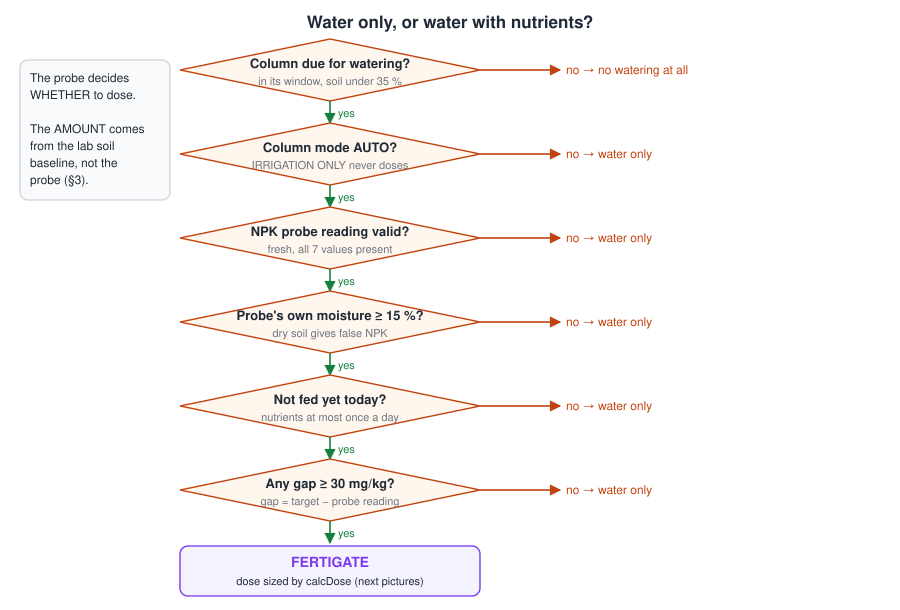
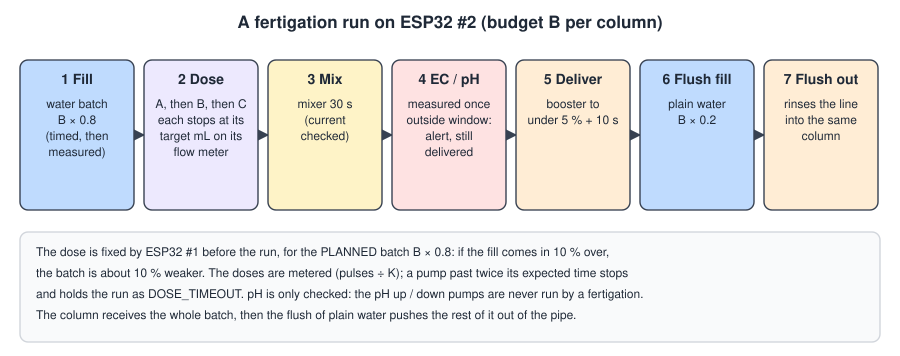
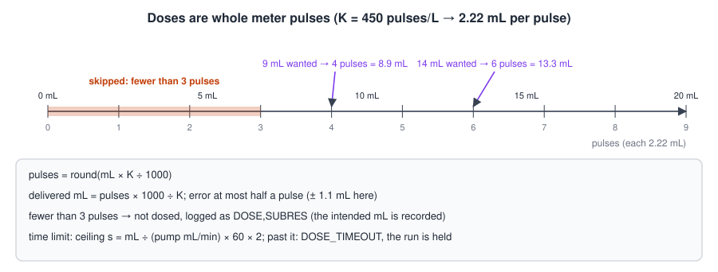
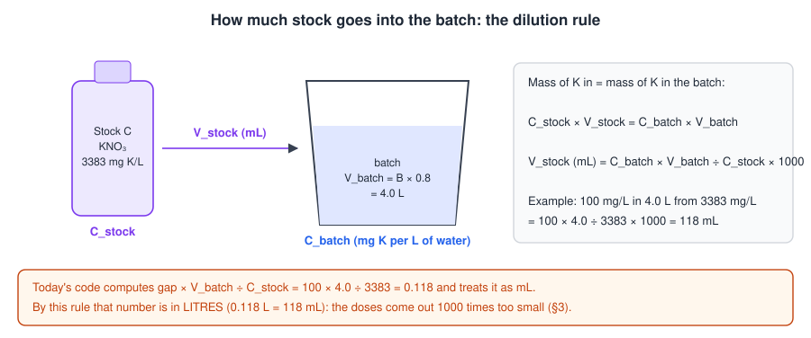
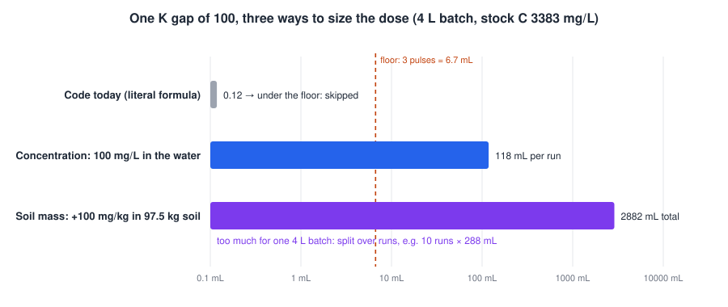

# Nutrients: how the dose is decided, and what to do for accurate dosing (web v.4)

*18 Nov 2026. Matches the web v.4 firmware. The formulas are the ones in ESP1 `decideFertigate` / `calcDose` and
ESP2's fertigation steps. Diagrams: `docs/nutrient_dosing/`. Companion to `Accurate_Water_Delivery_Guide.md`: the
nutrients ride on the water batch, so the litres must be right first.*

**In short:**
1. **Whether** a column gets nutrients is decided from the **live NPK probe**: target minus probe reading.
2. **How much** is decided from the **lab soil baseline** and the planned batch litres, with a formula whose units
   are not finished. Read with consistent units, its result is in litres but the code uses it as mL, so the doses
   come out about **1000 times smaller** (§5).
3. With today's settings **no nutrient is ever dosed**: every fertigation runs as watering only (§4).
4. Making dosing work needs one decision from you (the basis, §5), a firmware change, and then the manual work in
   §7.
5. **Until the firmware is fixed, calibrating the nutrient side is wasted time** (§6 says what is worth doing now).

---

## 1. Whether to add nutrients

A fertigation is only ever a variant of a scheduled watering. When a column is due for watering (inside its
window, soil under 35 %), ESP1 asks `decideFertigate` (`ESP1/src/main.cpp`):

| Check | Rule | If it fails |
| --- | --- | --- |
| Column mode | AUTO (IRRIGATION ONLY never doses) | water only |
| NPK probe | a fresh reading with all 7 values | water only, `NPK_FAULT` alert |
| The probe's own moisture | at least `NPK_MIN_MOIST_PCT` (15 %): in dry soil the probe's N, P, K are not trustworthy | water only, `FERT_DOWNGRADE\|reason=DRY_SOIL` |
| Once a day | not fed yet today (`fertStamp`) | water only |
| The gap | any of gapN, gapP, gapK ≥ `fertGap` (30 mg/kg, LCD Thresholds) | water only |

> gap_X (decision) = target_X − probe reading_X     (mg/kg, X = N, P, K)

The targets are per column (`SET,COL_x,N,..,P,..,K,..`, a crop preset, the LCD or the website). **They start at 0.**
A column with no targets set never fertigates. On 17 Nov Column B's decision was
`FERT_DECIDE|fert=0|gapN=0.0|gapP=-45.0|gapK=-37.0`: its targets were all 0.

---

## 2. How a fertigation runs

| Step | What happens | Amount |
| --- | --- | --- |
| 1 Fill | plain water into the mixing tank: since 18 Nov a timed run for 70 %, settle, measure, then a top-up for what is missing (water guide §1) | batch = B × (1 − 0.20) |
| 2 Dose | nutrient A, then B, then C (DC pumps, inverter off), each stopped by its flow meter at the target mL | per §3 |
| 3 Mix | the mixer runs `MIXING_DURATION_MS` (30 s, [TBD]); its current is checked | — |
| 4 EC / pH | one averaged reading each; outside the window (EC 0–3, pH 5–7, [TBD]) → `EC_FAIL` / `PH_FAIL` alert | the batch is delivered anyway (the tank has no drain) |
| 5 Deliver | the booster empties the tank into the column, to under 5 % + 10 s | the whole batch |
| 6–7 Flush | plain water, then delivered to the same column: pushes the rest of the batch out of the pump and pipe | B × 0.20 |

B is the column's water budget (`WATER_BUDGET_L`, 5 L now). The doses are fixed by ESP1 **before** the run, for the
**planned** batch B × 0.8. If the fill comes in 10 % over, the batch is about 10 % weaker. The two-step fill
(18 Nov) keeps a fill within about 1 L; before it, fills came in up to 53 % over.

**pH is only checked, never corrected:** the pH up / pH down pumps (and nutrient D) are wired but no fertigation runs
them.

---

## 3. How much: the dose formula as built

`calcDose` (`ESP1/src/main.cpp`), from `Nutrient_Dosing_Firmware_Spec.md` §3.1:

> gap_X (dose) = target_X − SOIL_BASELINE_X     (the lab report, not the probe)
> dose = gap_X × V_batch ÷ STOCK_X       (V_batch = B × 0.8 litres, STOCK in mg/L) → used as **mL**

| Nutrient | Pump | Sized from | Stock now (mg/L) |
| --- | --- | --- | --- |
| A, calcium nitrate (CALCINIT) | P1 | the N gap | 3100 N (also 3800 Ca) |
| B, mono-ammonium phosphate (MAP) | P7 | the P gap | 1338 P (also 590 N) |
| C, potassium nitrate (KNO₃) | P13 | the K gap | 3383 K (also 566 N) |

Lab soil baseline now (F.A.S.T. Labs MC2812-6783): **N 1060 mg/kg (Kjeldahl), P 80, K 200.**

**Only a positive gap doses.** Then the dose is rounded to whole flow-meter pulses:

> pulses = round(dose × K ÷ 1000)     delivered mL = pulses × 1000 ÷ K
> fewer than `MIN_DOSE_PULSES` (3) → not dosed, logged `ESP1,DOSE,SUBRES|NUT_x|int=..mL`
> time limit: ceiling (s) = mL ÷ (pump mL/min) × 60 × 2 → past it, `DOSE_TIMEOUT` holds the run

K is the meter's pulses per litre (Calibration → Flow Nut A/B/C; default 450, so 2.22 mL per pulse and a floor of
6.7 mL). The pump rate is Calibration → Rate Nut A/B/C (default 50 mL/min). ESP2 reports each dose as
`DOSE,NUT_x,<target mL>,<measured mL>,COL_y`, and it is written to the SD log.

---

## 4. Why nothing is dosed today

Four things stop it, each on its own:

| # | What | Effect |
| --- | --- | --- |
| 1 | B = 5 L, so the batch is 5 × 0.8 = **4 L**, under `MIXING_TANK_SAFE_MIN` (5 L) | `DOSE_BATCH_LOW`: water only, every time. B must be **at least 6.25 L** |
| 2 | The dose gap uses the lab baseline: N 1060 is above every target, and P / K are near the targets | only TOMATO_S2 (P +20) and TOMATO_S3 (K +100) give a positive gap (table below) |
| 3 | The formula's result is litres, not mL (§5) | 0.06–0.12 "mL": under 3 pulses, skipped |
| 4 | Column targets start at 0 | the column never fertigates until its targets are set |

**The crop presets against the lab baseline** (gap = target − baseline, mg/kg):

| Preset | N target / gap | P target / gap | K target / gap | Would dose |
| --- | --- | --- | --- | --- |
| PECHAY | 180 / −880 | 60 / −20 | 120 / −80 | nothing |
| TOMATO_S1 | 200 / −860 | 80 / 0 | 160 / −40 | nothing |
| TOMATO_S2 | 240 / −820 | 100 / +20 | 200 / 0 | B only: 20 × 4 ÷ 1338 = 0.06 → skipped |
| TOMATO_S3 | 150 / −910 | 80 / 0 | 300 / +100 | C only: 100 × 4 ÷ 3383 = 0.12 → skipped |

**Two mismatches in the inputs:**
- **The lab's N is total (Kjeldahl) N**, mostly organic and not available to the plants this season. The targets
  and the probe are about available N, so they can't be compared with 1060 directly.
- **The decision and the amount use different numbers.** The probe can say "N is 133 below target" and trigger a
  fertigation, while the dose, sized from the lab baseline, is zero.

---

## 5. The basis: the one decision needed

**The unit check.** The spec writes `dose_mL = gap × V_batch ÷ stock`. The gap is in mg per kg of soil, and soil
mass appears nowhere in it, so the formula only adds up if the gap is read as **mg per litre of water**. Read that way,
mg/L × L ÷ mg/L gives **litres**, and the code uses the number as mL. The spec's own §3.5 table, which needs "406 L"
of batch to reach 12 mL, comes from the same slip. So does its conclusion that the stock must be diluted about 8×:
at full strength, 100 mg/L of K in a 4 L batch already takes 118 mL of stock.

There are two standard ways to size a dose. They answer different questions and give very different amounts:

**Basis 1 — a concentration in the water (the usual fertigation practice).** You choose how many mg of each element
per litre of irrigation water (from the crop's fertigation recipe). Every run delivers that concentration:

> V_stock (mL) = C_water (mg/L) × V_batch (L) ÷ C_stock (mg/L) × 1000
> mass delivered to the column (mg) = C_water × V_batch

Example: K 100 mg/L in a 4.0 L batch from stock C (3383 mg/L) = 100 × 4.0 ÷ 3383 × 1000 = **118 mL** of stock C
(53 pulses at K = 450). It also brings N: 118 mL × 566 mg/L ÷ 1000 = 66.8 mg, about 16.7 mg/L of N in the batch.

**Basis 2 — raise the soil's nutrient level (what the lab gap literally means).** A gap in mg per kg of soil needs a
mass of nutrient for the whole root-zone soil, spread over several runs:

> soil mass (kg) = A (m²) × d (m) × ρ_b (g/cm³) × 1000
> nutrient needed (mg) = gap (mg/kg) × soil mass (kg) ÷ uptake efficiency
> V_stock total (mL) = nutrient needed ÷ C_stock × 1000,  per run = total ÷ number of runs

Example (made-up soil): 0.5 m² × 0.15 m × 1.3 × 1000 = 97.5 kg of soil. K +100 mg/kg needs 9,750 mg of K =
9,750 ÷ 3383 = **2.88 L** of stock C. That is far more than one 4 L batch can carry: for example 10 runs × 288 mL.

**Recommendation: Basis 1.**
- **It is what fertigation recipes are written in** (mg/L or ppm in the water). EC follows from it, so the EC
  check means something.
- **The probe can decide whether to feed; the recipe decides how much.**
- **Basis 2 needs the soil mass, bulk density and uptake efficiency per column**, and a plan to spread the total
  over many runs.

**Basis 1 needs two kinds of target per column.** The decision (§1) compares the targets with the probe, which reads
mg per kg of soil, so those targets must stay in mg/kg. The dose needs a recipe in mg per litre of water. Today there
is one set of targets, so Basis 1 adds a per-column (or per-preset) **recipe: N, P, K in mg/L**:
- **Soil targets (mg/kg)** decide *whether* to feed.
- **The recipe (mg/L)** decides *how much*.

Basis 2 keeps one set of targets in mg/kg, but needs each column's soil mass instead.

**Either way it is a firmware change in `calcDose`**:
- **Basis 1:** the ×1000, a recipe setting, and the lab baseline no longer used.
- **Basis 2:** the soil mass per column.

Both also need new values for the stock table. I will make the change once you choose.

**The water left in the mixing tank (found 18 Nov).** A delivery stops at the 0 % mark, which the tape showed is
4.6 cm of water, about **4.3 L** (water guide §3). That water stays in the tank and mixes into the next batch, so a
dose worked out for a 4 L batch ends up in about 8.3 L, and only half of it reaches the column. The firmware change
must count it: dose for (batch + 4.3 L) at the recipe strength, or deliver the tank lower before a fertigation.

---

## 6. Is it worth it? What to do now, and what to leave

**Nothing is dosed until the formula is fixed (§5).** Meter calibration, pump rates, priming and batch checks cannot
change a single run before that. Do them right after the firmware change, not before.

| Task (§7 #) | Your time | Worth it now? | Why |
| --- | --- | --- | --- |
| Choose the basis (§5) | 10 min | **Yes, first** | everything else waits on it |
| 1 Water budget ≥ 6.25 L | 15 min + flash | **Yes, with the firmware change** | under it, no dose is ever sent; it also changes the watering, so set it from the water guide's §9, not just to clear the minimum |
| 3 Column targets (and the recipe, Basis 1) | 10 min | **Yes, now** | today's 0 targets mean no column ever fertigates |
| 2 Make the stocks and record their strength | 1 h | **Yes, now** | every dose is divided by it; it can be done before the firmware change |
| 4 Meter K, A / B / C | 1.5 h (3 runs × 3) | **After the fix: yes** | directly scales every dose |
| 5 Pump rates | 0 extra | **After the fix: yes** | read them from the same runs as #4 (mL ÷ minutes); they only set the time limit |
| 6 Prime the lines | 5 min per session | **After the fix: yes, every time** | air trips `DOSE_TIMEOUT` |
| 7 pH and EC probes | 20 min | **After the fix: worth it** | the system only checks, never corrects; needed for the thesis records |
| 8 Mixing time | 20 min, once | **Low priority** | 30 s is likely enough for a 4–15 L tank; check once with EC |
| 9 Check a batch by hand | 20 min per new stock | **After the fix: yes** | one test that catches a wrong stock strength or meter K |
| 10 Record the outcome | ongoing | **Yes** | it is the thesis result |

**Order:** choose the basis → firmware change → water budget, targets and stocks → meters and pump rates → prime →
check a batch by hand → first real fertigation.

---

## 7. The manual work for accurate dosing

Do these after the water steps of `Accurate_Water_Delivery_Guide.md`. The dose is only as right as the batch litres.

| # | Task | How | Why |
| --- | --- | --- | --- |
| 1 | **Water budget ≥ 6.25 L** | `WATER_BUDGET_L` in `shared/rig_constants.h`, flash both ESP32s | the batch (B × 0.8) must be at least 5 L to dose |
| 2 | **Make the stock solutions and record their real strength** | Weigh the salt, dissolve, make up to a measured volume; work out mg of N, P, K per litre from the salt's label (pure KNO₃ is 13.9 % N and 38.7 % K: 100 g in 10 L gives 1390 mg/L N and 3870 mg/L K) | `STOCK_A_N`, `STOCK_B_P`, `STOCK_C_K` (and the side N) are the divisor of every dose |
| 3 | **Set each column's targets** | a preset or `SET,COL_x,…`: mg/kg in the soil (the decision). With Basis 1, also the column's recipe in mg/L of water (a new setting the firmware change adds) | targets start at 0 |
| 4 | **Calibrate the dosing meters** | Calibration → Flow Nut A / B / C: pump into a measuring cylinder 3 times; K = pulses ÷ litres | the meter decides when each pump stops |
| 5 | **Measure the pump rates** | from the same runs as #4: mL ÷ minutes; enter it on Calibration → Rate Nut A / B / C | sets the 2× time limit; too low gives false `DOSE_TIMEOUT` |
| 6 | **Prime the lines** | hold-to-prime on the Flow Nut rows until no air comes out | air reads as no flow and trips `DOSE_TIMEOUT` |
| 7 | **pH and EC probes** | Calibration → pH (7 then 4), EC (0 then the 1.413 mS/cm standard) | the batch check |
| 8 | **Mixing time** | Make a batch, read EC every 10 s while mixing; the time it stops changing is the mixing time (`MIXING_DURATION_MS`) | 30 s is a placeholder |
| 9 | **Check a batch by hand** | Put the same mL of stock into the same litres of water in a bucket, stir, measure EC and pH; compare with the system's reading | catches a wrong stock strength or meter K |
| 10 | **Record the outcome** | NPK probe readings before and a few days after; the `DOSE` log lines (target and measured mL) | the probe is the outcome measure, never a mid-dose input |

**The meter calibration formula** (Flow Nut rows, 3 runs, outlier check `CAL_OUTLIER_PCT` 8 %):

> K (pulses/L) = pulses counted ÷ (mL in the cylinder ÷ 1000)

**Check a dose after a run:** ESP2 reports each dose as a `DOSE` line with the nutrient, the target mL, the measured
mL and the column, for example NUT_C, 118.2, 117.8, COL_A: target 118.2 mL, measured 117.8 mL.
A measured figure far from the target, with the meter calibrated, means air in the line or a slipping pump.

---

## 8. All nutrient formulas in one place

| # | Formula | Where |
| --- | --- | --- |
| 1 | decide: any (target − probe) ≥ 30 mg/kg, probe moisture ≥ 15 %, AUTO, not fed today | `decideFertigate` |
| 2 | V_batch = B × (1 − 0.20); no dose if V_batch < 5 L | `calcDose` |
| 3 | as built: dose = (target − baseline) × V_batch ÷ STOCK, used as mL | `calcDose` |
| 4 | Basis 1: V_stock (mL) = C_water × V_batch ÷ C_stock × 1000 | proposed |
| 5 | Basis 2: V_stock total (mL) = gap × (A × d × ρ_b × 1000) ÷ efficiency ÷ C_stock × 1000 | proposed |
| 6 | pulses = round(mL × K ÷ 1000); delivered = pulses × 1000 ÷ K; under 3 pulses: skip | `calcDose` |
| 7 | ceiling (s) = mL ÷ (mL/min) × 60 × 2 | `calcDose` → `DCEIL` |
| 8 | side N from B or C = mL × STOCK_x_N ÷ 1000 (mg) | — |
| 9 | concentration in the batch = mg of element ÷ V_batch (mg/L) | — |
| 10 | flush = B × 0.20 of plain water after the batch | ESP2 `SEQ_FLUSH_*` |
| 11 | meter K = pulses ÷ litres | Calibration → Flow Nut |

## 9. Where each value lives

| Value | Now | Set with | Stored |
| --- | --- | --- | --- |
| Column targets N / P / K / pH | 0 until set | SMS `SET`, preset, LCD, website | ESP1 NVS |
| Decision gap `fertGap` | 30 mg/kg | LCD Thresholds, SMS `THRESH`, website | ESP1 NVS |
| Probe moisture minimum | 15 % | firmware | `NPK_MIN_MOIST_PCT` (ESP1 `pure_math.h`) |
| Soil baseline N / P / K | 1060 / 80 / 200 mg/kg | firmware | `SOIL_BASELINE_*` (ESP1) |
| Stock strengths | A 3100 N; B 1338 P; C 3383 K (mg/L) | firmware | `STOCK_*` (ESP1) |
| Flush share | 20 % | firmware | `FLUSH_PCT` (ESP1) |
| Smallest batch that doses | 5 L | firmware | `MIXING_TANK_SAFE_MIN` (ESP1) |
| Smallest dose | 3 pulses | firmware | `MIN_DOSE_PULSES` (ESP1) |
| Meter K, A / B / C | 450 pulses/L | Calibration → Flow Nut A/B/C | ESP1 NVS `kNA`/`kNB`/`kNC` |
| Pump rate, A / B / C | 50 mL/min | Calibration → Rate Nut A/B/C | ESP1 NVS `pumpA`/`pumpB`/`pumpC` |
| Mixing time | 30 s | firmware | `MIXING_DURATION_MS` (ESP1) |
| EC / pH windows | 0–3 mS/cm / 5–7 | firmware | `EC_MIN/MAX`, `PH_MIN/MAX` (ESP1) |

See also: `Nutrient_Dosing_Firmware_Spec.md` (the original dosing design), the reference §14.2 (fertigation logic)
and §12.2.2 (crop presets).
